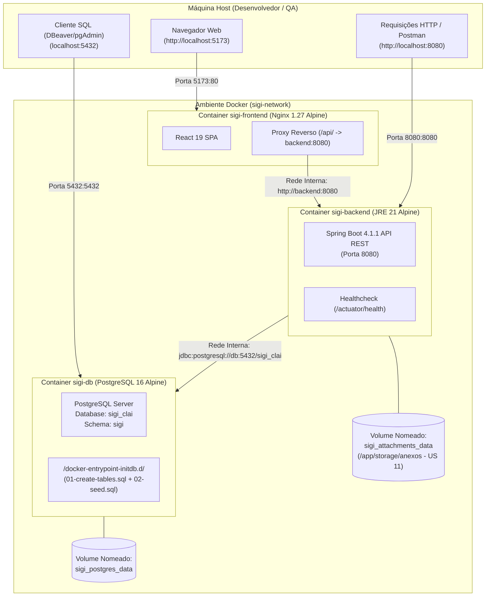

# 🐳 Guia de Execução com Docker — SIGI / CLAI

Este documento orienta a equipe de desenvolvimento e QA sobre como executar, testar e administrar o ambiente completo do **Sistema Integrado de Gestão Inclusiva (SIGI / CLAI)** utilizando Docker e Docker Compose de forma isolada, padronizada e reprodutível.

---

## 🏗️ 1. Arquitetura dos Containers

A stack é composta por 3 serviços orquestrados na rede interna isolada `sigi-network`:



### 📋 Mapeamento de Portas e Volumes

| Serviço | Container | Imagem Base | Porta Host | Porta Container | Volume / Finalidade |
| :--- | :--- | :--- | :--- | :--- | :--- |
| **`db`** | `sigi-db` | `postgres:16-alpine` | `5432` | `5432` | `sigi_postgres_data` (persistência das tabelas e dados) |
| **`backend`** | `sigi-backend` | `eclipse-temurin:21-jre-alpine` | `8080` | `8080` | `sigi_attachments_data` (armazenamento de anexos da US 11 em `/app/storage/anexos`) |
| **`frontend`** | `sigi-frontend` | `nginx:1.27-alpine` | `5173` | `80` | Servir SPA React compilado e proxy reverso para API |

---

## 🚀 2. Passo a Passo de Inicialização

### Pré-requisitos
* **Docker Desktop** (Windows / macOS) ou **Docker Engine + Docker Compose v2** (Linux) instalado e em execução.
* Portas `5173`, `8080` e `5432` livres na sua máquina host (ou configuradas no arquivo `.env`).

### Passo 1 — Criar o arquivo `.env` a partir do modelo
Abra o terminal na **raiz do repositório** e copie o modelo:

* **No Windows (PowerShell):**
  ```powershell
  Copy-Item .env.example .env
  ```
* **No Linux / macOS (Bash):**
  ```bash
  cp .env.example .env
  ```

> [!NOTE]
> O arquivo `.env` contém valores padrão ideais para desenvolvimento local. Você só precisa alterá-lo caso queira mudar portas ou credenciais.

### Passo 2 — Subir toda a aplicação com um único comando
Na **raiz do repositório**, execute:

```bash
docker compose up -d --build
```

O Docker realizará:
1. O download das imagens base (`postgres`, `eclipse-temurin`, `node`, `nginx`).
2. O build multi-stage do Backend (Maven compila o `.jar` e gera imagem JRE enxuta).
3. O build multi-stage do Frontend (TypeScript compila o bundle estático e Nginx é configurado).
4. A inicialização automática do banco com criação do schema `sigi`, tabelas e dados iniciais de teste (seed).
5. Os *healthchecks* aguardam a prontidão de cada dependência antes de liberar o próximo serviço.

### Passo 3 — Verificar a saúde dos containers
```bash
docker compose ps
```
Você verá os 3 serviços com status **`Up (healthy)`**:
```text
NAME            IMAGE               STATUS
sigi-backend    ...-backend:latest  Up (healthy)
sigi-db         postgres:16-alpine  Up (healthy)
sigi-frontend   ...-frontend:latest Up (healthy)
```

Pronto! Acesse:
* 🌐 **Frontend:** [http://localhost:5173](http://localhost:5173)
* ⚙️ **API REST / Actuator:** [http://localhost:8080/actuator/health](http://localhost:8080/actuator/health)

---

## 🗄️ 3. Como Conectar ao Banco de Dados (DBeaver / pgAdmin / DataGrip)

Você pode conectar qualquer cliente SQL externo diretamente ao PostgreSQL do container:

| Propriedade | Valor |
| :--- | :--- |
| **Host / IP** | `localhost` (ou `127.0.0.1`) |
| **Porta** | `5432` (ou o valor de `DB_PORT` no `.env`) |
| **Database** | `sigi_clai` |
| **Username** | `postgres` |
| **Password** | `postgres` (ou o valor de `POSTGRES_PASSWORD` no `.env`) |
| **Schema Padrão** | `sigi` |

### Dica no DBeaver
Ao criar a conexão PostgreSQL no DBeaver:
1. Informe **Host:** `localhost`, **Database:** `sigi_clai`, **Usuário:** `postgres`, **Senha:** `postgres`.
2. Clique em **Test Connection**.
3. Na aba do navegador de banco, expanda: `Databases > sigi_clai > Schemas > sigi > Tables` para visualizar as 8 tabelas criadas automaticamente (`aluno`, `estudo_de_caso`, `pei`, `pea`, etc.).

---

## 🛠️ 4. Comandos Úteis do Dia a Dia

### Ver logs em tempo real
```bash
# Ver logs de todos os serviços simultaneamente
docker compose logs -f

# Ver logs apenas do backend
docker compose logs -f backend

# Ver logs apenas do banco
docker compose logs -f db

# Ver logs apenas do frontend
docker compose logs -f frontend
```

### Parar e reiniciar os containers (mantendo dados persistidos)
```bash
# Parar os containers sem remover nada
docker compose stop

# Retomar os containers
docker compose start

# Parar e remover containers e redes (os volumes de dados são PRESERVADOS)
docker compose down
```

### Recompilar apenas um serviço após alterações de código
Se você alterou o código do backend ou do frontend e quer atualizar apenas aquele container:
```bash
# Rebuildar apenas o backend
docker compose up -d --build backend

# Rebuildar apenas o frontend
docker compose up -d --build frontend
```

### Executar comandos SQL dentro do container do banco
```bash
# Acessar o terminal interativo psql
docker exec -it sigi-db psql -U postgres -d sigi_clai

# Consultar tabelas rapidamente via linha de comando
docker exec -it sigi-db psql -U postgres -d sigi_clai -c "SELECT nome, matricula FROM sigi.aluno;"
```

### Limpar e resetar o banco de dados (CUIDADO: apaga dados locais)
> [!CAUTION]
> O comando abaixo remove todos os dados salvos no banco PostgreSQL e os anexos salvos, recriando o banco do zero no próximo `up`:

```bash
docker compose down -v
docker compose up -d --build
```

---

## 🔍 5. Guia Rápido de Troubleshooting

### Problema 1: "port is already allocated" (Conflito de portas locais)
* **Causa:** Você já tem um PostgreSQL local rodando na porta `5432`, ou um processo Spring/Tomcat rodando na `8080`, ou um Vite na `5173`.
* **Solução:**
  - **Opção A (Recomendada):** Pare o serviço local concorrente (ex: no Windows, abra `services.msc` e pare o serviço `postgresql-x64-16`, ou feche a aba onde executava `npm run dev` / `./mvnw spring-boot:run`).
  - **Opção B:** Altere as portas no arquivo `.env` para portas alternativas livres:
    ```env
    DB_PORT=5433
    BACKEND_PORT=8081
    FRONTEND_PORT=5174
    ```
    Depois, suba novamente com `docker compose up -d`.

### Problema 2: Frontend responde com HTML antigo ou script do Vite em vez do Nginx
* **Causa:** Um processo local do Vite (`npm run dev`) foi deixado rodando em segundo plano na mesma porta (`5173`). No Windows, o IPv6 `[::1]:5173` intercepta o tráfego do navegador antes do Docker `127.0.0.1:5173`.
* **Solução:** Encerre o processo do terminal que está rodando `npm run dev` ou acesse explicitamente via `http://127.0.0.1:5173`.

### Problema 3: "open //./pipe/dockerDesktopLinuxEngine: The system cannot find the file specified"
* **Causa:** O Docker Desktop não está iniciado no Windows ou a engine do WSL 2 ainda está inicializando.
* **Solução:** Abra o aplicativo **Docker Desktop**, aguarde o ícone de status ficar verde ("Engine running") e reexecute o comando.

### Problema 4: "Cannot find path .env.example"
* **Causa:** O comando `Copy-Item` ou `docker compose` foi executado dentro de uma subpasta (`app/backend` ou `app/frontend`) em vez da raiz do projeto.
* **Solução:** Navegue até a raiz do repositório (`cd ../..`) e execute o comando a partir de lá.

### Problema 5: Erro de quebra de linha CRLF em scripts no Windows
* **Causa:** O Git no Windows converte quebras de linha para `CRLF`, o que pode causar erros em scripts shell no Linux (`/bin/sh^M: bad interpreter`).
* **Proteção embutida:** Os `Dockerfile`s do projeto já possuem tratamentos automáticos com `sed -i 's/\r$//'` para evitar esse problema. Caso enfrente problemas em outros scripts, converta o arquivo para fim de linha LF na sua IDE.
