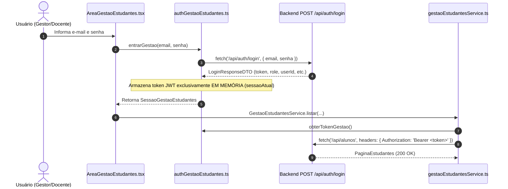
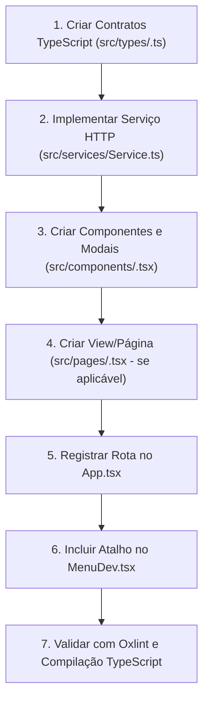

# SIGI / CLAI — Documentação Técnica do Front-end

Documentação técnica oficial e **Fonte da Verdade** da aplicação Single Page Application (SPA) do **Sistema Integrado de Gestão Inclusiva (SIGI)** da **Coordenação Local de Acessibilidade e Inclusão (CLAI)** do Instituto Federal da Paraíba (IFPB) — Campus Cajazeiras.

Este documento foi projetado especificamente para servir como guia de contexto para **Agentes de IA** e desenvolvedores de software, permitindo criar, manter e refatorar funcionalidades com precisão cirúrgica, contratos rígidos e zero alucinação.

- Código-fonte do front-end: [`app/frontend`](.)
- Documentação da API Back-end (Spring Boot): [`app/backend/README.md`](../backend/README.md)
- Guia de execução integrada via Docker: [`DOCKER_GUIDE.md`](../../DOCKER_GUIDE.md)
- Visão geral do repositório: [`README.md`](../../README.md)

---

## Sumário

1. [Visão Geral & Stack Tecnológica](#1-visão-geral--stack-tecnológica)
2. [Arquitetura & Árvore de Diretórios](#2-arquitetura--árvore-de-diretórios)
3. [Padrões de Código & Convenções (Regras para o Agente)](#3-padrões-de-código--convenções-regras-para-o-agente)
4. [Roteamento, Autenticação & Controle de Acesso](#4-roteamento-autenticação--controle-de-acesso)
5. [Integração com API & Gerenciamento de Estado](#5-integração-com-api--gerenciamento-de-estado)
6. [Formulários, Validações & Feedback Visual](#6-formulários-validações--feedback-visual)
7. [Guia Passo a Passo para Novas Features (Playbook do Agente)](#7-guia-passo-a-passo-para-novas-features-playbook-do-agente)
8. [Comandos de Execução & Variáveis de Ambiente](#8-comandos-de-execução--variáveis-de-ambiente)

---

## 1. Visão Geral & Stack Tecnológica

### Propósito da Aplicação

O front-end do **SIGI / CLAI** é a interface web corporativa que centraliza o acolhimento, triagem e acompanhamento pedagógico de estudantes com necessidades específicas atendidos pelo NAPNE/CLAI do IFPB. Suas responsabilidades incluem:

- **Ficha do Estudante / Prontuário Eletrônico:** Visualização consolidada dos dados cadastrais do aluno, indicadores de acessibilidade e linha do tempo de atendimentos.
- **Gestão de Estudantes (US 12):** Painel administrativo com autenticação JWT, busca com debounce, filtros combinados (curso, turma, tag de dificuldade e status ativo/inativo), cadastro, edição cadastral e inativação lógica (`INATIVO` / `EVADIDO`).
- **Estudo de Caso Multidisciplinar:** Registro do diagnóstico inicial e vínculo de indicadores/barreiras com suporte a rascunho (`RASCUNHO`), conclusão (`ATIVO`) e encerramento (`ENCERRADO`).
- **Planejamento Pedagógico (PEI & PEA):** Elaboração e consulta do Plano Educacional Individualizado (PEI) e Planos de Ensino Adaptados por disciplina (PEA).
- **Linha do Tempo (Timeline):** Rastreamento cronológico de todos os eventos educacionais, estudos de caso, planos pedagógicos e atendimentos do discente.

---

### Stack Tecnológica Detalhada

As ferramentas e versões abaixo foram extraídas diretamente dos arquivos de configuração oficiais ([`package.json`](package.json), [`tsconfig.app.json`](tsconfig.app.json), [`vite.config.ts`](vite.config.ts) e [`Dockerfile`](Dockerfile)):

| Categoria | Tecnologia | Versão Exata | Papel e Observações no Projeto |
| :--- | :--- | :--- | :--- |
| **Framework UI** | React | `^19.2.8` | Biblioteca base de componentes declarativos (React 19). |
| **Renderizador** | React DOM | `^19.2.8` | Acoplado via `createRoot` em `src/main.tsx`. |
| **Linguagem** | TypeScript | `~6.0.2` | Configurado com Target ES2023, Bundler resolution, `verbatimModuleSyntax: true` e `erasableSyntaxOnly: true`. |
| **Build Tool / Bundler** | Vite | `^8.3.0` | Servidor de desenvolvimento rápido e bundler de produção com proxy reverso local de `/api`. |
| **Plugin React** | `@vitejs/plugin-react` | `^6.1.1` | Fast Refresh e integração JSX/TSX utilizando parser Oxc. |
| **Estilização** | Tailwind CSS | `^3.4.19` | Utility-first CSS com paleta estendida da identidade visual do IFPB. |
| **Processador CSS** | PostCSS | `^8.5.29` | Pipeline de compilação CSS acoplado ao Tailwind. |
| **Prefixer CSS** | Autoprefixer | `^10.6.1` | Injeção de vendor prefixes para compatibilidade de browsers. |
| **Ícones** | Lucide React | `^1.55.0` | Biblioteca exclusiva de ícones vetoriais SVG acessíveis. |
| **Roteamento** | React Router DOM | `^7.18.4` | Roteador SPA declarativo baseado em `BrowserRouter`, `Routes`, `Route`, `useNavigate` e `useLocation`. |
| **Linter Estático** | Oxlint | `^1.81.0` | Linter estático em Rust configurado com regras para React, TypeScript e Oxc em `.oxlintrc.json`. |
| **Cliente HTTP** | `fetch` Nativo | *Nativo* | Wrapper `apiFetch` em `src/services/apiClient.ts` com tratamento padronizado de erros RFC 9457 (`ApiProblem`). *(Axios não utilizado)*. |
| **Gerenciamento de Estado** | React Hooks | *Nativo* | Estado local com `useState`, `useRef`, `useCallback` e elevação de estado (*state lifting*) em `App.tsx`. *(Redux/Zustand não adotados)*. |
| **Formulários & Validação** | React Controlado | *Nativo* | Formulários controlados (`value` + `onChange`), validações manuais síncronas e mapeamento de erros da API. *(React Hook Form / Zod não adotados)*. |
| **Servidor de Produção** | Nginx Alpine | `1.27-alpine` | Imagem de runtime Docker que serve assets estáticos e atua como proxy reverso para `/api/` do backend. |
| **Testes Automatizados** | — | — | **Não implementado / Pendente de padronização** *(recomendado: Vitest + Testing Library)*. |

---

## 2. Arquitetura & Árvore de Diretórios

### Árvore da Pasta `src/`

```text
app/frontend/src/
├── assets/                          # Ativos estáticos compilados
│   ├── imagens/
│   │   └── ifpb.png                 # Brasão oficial do IFPB Campus Cajazeiras
│   ├── hero.png
│   ├── react.svg
│   └── vite.svg
├── components/                      # Componentes de interface e formulários modulares
│   ├── AreaGestaoEstudantes.tsx     # Wrapper com gate de login in-page para Gestão de Estudantes
│   ├── ConfirmModal.tsx             # Modal genérico de confirmação com ações destrutivas
│   ├── FormularioEstudoDeCaso.tsx   # Formulário completo de Estudo de Caso (Rascunho e Conclusão)
│   ├── FormularioPea.tsx            # Formulário de Plano de Ensino Adaptado (por disciplina)
│   ├── FormularioPei.tsx            # Formulário de Plano Educacional Individualizado
│   ├── HeaderIFPB.tsx               # Cabeçalho padrão IFPB com logo institucional, título e menu hambúrguer RBAC
│   ├── ModalAlunoHeader.tsx         # Modal de exibição detalhada dos dados do estudante
│   ├── ModalBase.tsx                # Modal base com backdrop, ARIA dialog, ESC e bloqueio de scroll
│   ├── ModalConfirmacaoAcao.tsx     # Confirmação para emissão de RAE e Dossiê do Estudante
│   ├── ModalEstudante.tsx           # Modal de criação e edição cadastral de estudantes (US 12)
│   ├── ModalInativarEstudante.tsx   # Modal de inativação lógica do estudante (INATIVO/EVADIDO)
│   ├── ModalNovoAtendimento.tsx     # Modal de registro rápido de novo atendimento
│   ├── ModalNovoEstudo.tsx          # Modal de criação rápida de rascunho/estudo a partir do prontuário
│   ├── ProntuarioQuickActions.tsx   # Barra de atalhos rápidos do prontuário (US 09)
│   ├── StudentHeader.tsx            # Cabeçalho da ficha do discente (nome, matrícula, tags de acessibilidade)
│   ├── TelaAluno.tsx                # Aba principal da ficha do aluno e visão dos planos vigentes
│   ├── Timeline.tsx                 # Contêiner cronológico de eventos do discente
│   ├── TimelineItem.tsx             # Item individual de evento na linha do tempo
│   └── ToastAlert.tsx               # Notificações flutuantes (sucesso, erro, alerta)
├── config/                          # Constantes de configuração e flags de runtime
│   └── featureFlags.ts              # API_URL e flag USE_LOCAL_FALLBACK
├── pages/                           # Visões completas de rota
│   └── GestaoEstudantes.tsx         # Painel de listagem, busca debounced, filtros e paginação (US 12)
├── services/                        # Camada de comunicação com a API REST
│   ├── alunoService.ts              # Serviço de obtenção do cabeçalho do aluno
│   ├── apiClient.ts                 # Cliente HTTP fetch unificado com tratamento RFC 9457
│   ├── authGestaoEstudantes.ts      # Autenticação JWT em memória para a Gestão de Estudantes
│   ├── estudoDeCasoService.ts       # CRUD de Estudo de Caso com fallback local opcional
│   ├── gestaoEstudantesService.ts   # CRUD e busca paginada de estudantes com Bearer Token
│   ├── peaService.ts                # Operações de PEA (Planos Adaptados)
│   ├── peiService.ts                # Operações de PEI (Plano Individualizado)
│   ├── prontuarioService.ts         # Agregação do prontuário, atendimentos e emissão de documentos
│   └── timelineService.ts           # Agregação cronológica de eventos da timeline
├── types/                           # Contratos de dados TypeScript e DTOs
│   ├── alunoHeader.ts               # Contrato do cabeçalho resumido do estudante
│   ├── estudoDeCaso.ts              # DTOs de Estudo de Caso e RFC 9457 ProblemDetail
│   ├── gestaoEstudantes.ts          # DTOs de paginação, filtros e formulário de estudantes
│   ├── pea.ts                       # DTOs de PEA (Request, Response, Update)
│   ├── pei.ts                       # DTOs de PEI (Request, Response, Update)
│   ├── prontuarioAcoes.ts           # DTOs de ações do prontuário (atendimentos, dossiê, RAE)
│   └── timeline.ts                  # DTO do evento de linha do tempo
├── utils/                           # Utilitários puros
│   └── data.ts                      # Formatação de datas em fuso horário local (evita shift UTC)
├── App.css                          # Arquivo legado do template (não utilizado na estilização)
├── App.tsx                          # Componente raiz: rotas, orquestração de estado e modais
├── index.css                        # Estilos globais e diretivas @tailwind
└── main.tsx                         # Ponto de entrada React com StrictMode e BrowserRouter
```

---

### Responsabilidades por Diretório

| Diretório | Responsabilidade | O que DEVE conter | O que NÃO DEVE conter |
| :--- | :--- | :--- | :--- |
| `src/assets/` | Ativos estáticos | Imagens PNG, SVGs institucionais, ícones fixos | Código TypeScript, arquivos CSS soltos |
| `src/components/` | Componentes reutilizáveis | Modais, formulários, botões, headers, elementos de layout | Chamadas HTTP `fetch` diretas sem passar por `services/` |
| `src/config/` | Configurações de execução | Constantes derivadas de variáveis de ambiente (`import.meta.env`) | Lógica de negócio, estados ou JSX |
| `src/pages/` | Telas de rotas completas | Composição de componentes para compor uma página de rota inteira | Regras de persistência em baixo nível |
| `src/services/` | Camada de integração | Funções ou classes de integração HTTP via `apiFetch`, tratamento de resposta e normalização de DTOs | Elementos visuais JSX ou hooks de UI |
| `src/types/` | Contratos estáticos | Interfaces TypeScript, types e enums que espelham DTOs do backend | Lógica executável ou valores de runtime (exceto types/enums) |
| `src/utils/` | Funções puras | Utilitários determinísticos (ex: datas, normalizações, máscaras) | Efeitos colaterais de rede ou dependência de estado React |

---

### Regra de Ouro: Onde criar novos arquivos

Ao receber comandos para criar novas funcionalidades, o Agente de IA deve seguir rigorosamente a matriz abaixo:

1. **Novos Contratos / DTOs:** Crie em `src/types/<feature>.ts`. Sempre declare interfaces separadas para Request, Response e Update (`<Nome>RequestDTO`, `<Nome>ResponseDTO`, `<Nome>UpdateDTO`).
2. **Novas Chamadas de API:** Crie em `src/services/<feature>Service.ts`. Utilize sempre `apiFetch` de `apiClient.ts` e declare tipagem estrita de retorno.
3. **Novos Componentes ou Modais:** Crie em `src/components/<NomeComponente>.tsx`. Se for um modal, envolva o conteúdo com `<ModalBase>`.
4. **Novas Páginas / Telas:** Crie em `src/pages/<NomeDaPagina>.tsx` e registre a rota correspondente dentro de `<Routes>` em `src/App.tsx`.
5. **Novas Constantes de Ambiente:** Declare a tipagem e exporte em `src/config/featureFlags.ts` a partir de `import.meta.env`.

---

## 3. Padrões de Código & Convenções (Regras para o Agente)

### Convenções de Nomenclatura

- **Componentes React:** `PascalCase.tsx` (ex: `ModalEstudante.tsx`, `StudentHeader.tsx`, `ConfirmModal.tsx`).
- **Arquivos de Serviço:** `camelCase.ts` (ex: `alunoService.ts`, `timelineService.ts`, `apiClient.ts`) ou classes estáticas `PascalCase` dentro de arquivo camelCase (`gestaoEstudantesService.ts` contendo `GestaoEstudantesService`).
- **Arquivos de Tipos:** `camelCase.ts` (ex: `estudoDeCaso.ts`, `gestaoEstudantes.ts`).
- **Interfaces e Tipos:** `PascalCase` sem prefixo `I` (ex: `EstudanteResumo`, `ModalBaseProps`).
  - DTOs que trafegam na rede **devem** ter o sufixo `DTO` (ex: `PeiRequestDTO`, `PeiResponseDTO`).
- **Variáveis e Funções:** `camelCase` (ex: `carregarEstudosDoAluno`, `sessaoAtual`).
- **Constantes de Módulo:** `UPPER_SNAKE_CASE` (ex: `TAMANHO_PAGINA`, `API_URL`, `USE_LOCAL_FALLBACK`).

---

### Estrutura de Componentes & TypeScript Estrito

> [!IMPORTANT]
> **Obrigatório: `verbatimModuleSyntax`:**
> O arquivo `tsconfig.app.json` ativa `"verbatimModuleSyntax": true`. Isso significa que importações de interfaces e tipos **devem obrigatoriamente** utilizar a palavra-chave `type`:
> ```tsx
> // CORRETO:
> import type { EstudanteResumo } from '../types/gestaoEstudantes';
> import { useState, type FormEvent } from 'react';
> 
> // INCORRETO (gera erro de compilação no build):
> import { EstudanteResumo } from '../types/gestaoEstudantes';
> ```

#### Padrão de Escrita de Componente

Os componentes do projeto adotam tanto `export const Componente: React.FC<Props>` quanto `export function Componente({ ... }: Props)`. Recomenda-se o padrão com `export function` ou `export const` com tipagem explícita de Props logo acima do componente:

```tsx
// Exemplo real extraído de src/components/ModalBase.tsx
import React, { useEffect } from 'react';
import { X } from 'lucide-react';

export interface ModalBaseProps {
  isOpen: boolean;
  onClose: () => void;
  titulo: string;
  subtitulo?: string;
  icone?: React.ReactNode;
  children: React.ReactNode;
  footer?: React.ReactNode;
  maxWidthClass?: string;
  isLoading?: boolean;
}

export const ModalBase: React.FC<ModalBaseProps> = ({
  isOpen,
  onClose,
  titulo,
  subtitulo,
  icone,
  children,
  footer,
  maxWidthClass = 'max-w-2xl',
  isLoading = false,
}) => {
  // Lógica do componente com hooks React
  if (!isOpen) return null;

  return (
    <div className="fixed inset-0 z-50 flex items-center justify-center p-4" role="dialog" aria-modal="true">
      {/* Conteúdo */}
    </div>
  );
};
```

- **Named Exports:** Todos os componentes reutilizáveis devem usar *named exports* (`export const ...` ou `export function ...`). O `export default` é reservado exclusivamente para o componente raiz (`App.tsx`).

---

### Estilização & Design System (Tailwind CSS)

O projeto não utiliza CSS Modules nem bibliotecas CSS-in-JS (como styled-components). Toda a estilização é feita via **classes utilitárias do Tailwind CSS**.

#### Paleta Institucional IFPB ([`tailwind.config.js`](tailwind.config.js))

O Tailwind foi configurado com a paleta oficial do IFPB Campus Cajazeiras sob o namespace `ifpb`:

```js
// Configuração em tailwind.config.js
theme: {
  extend: {
    colors: {
      ifpb: {
        teal: '#0F6460',          // Verde-petróleo principal institucional
        tealHover: '#0B4F4C',     // Hover do verde-petróleo
        tealLight: '#E6F0EF',     // Fundo suave de destaque
        green: '#3FA14C',         // Verde bandeira IFPB
        greenHover: '#2E8B3B',     // Hover do verde
        greenLight: '#EBF6EC',     // Tags e badges de sucesso
        breadcrumb: '#EEF1EC',    // Barras de navegação secundárias
        dark: '#424242',          // Tipografia principal
        blue: '#3083EE',          // Links e botões informativos
        red: '#C8102E',           // Ações destrutivas e alertas
      }
    }
  }
}
```

#### Classes Dinâmicas (Sem `clsx` / `tailwind-merge`)

Como `clsx` e `tailwind-merge` **não estão instalados**, classes dinâmicas devem ser compostas com **Template Literals** padrão do JavaScript:

```tsx
// Exemplo real de composição dinâmica em src/components/ToastAlert.tsx
className={`p-4 rounded-xl shadow-lg border flex items-start space-x-3 transition-all duration-300 ${
  toast.tipo === 'sucesso'
    ? 'bg-emerald-50 border-emerald-200 text-emerald-900'
    : toast.tipo === 'erro'
    ? 'bg-red-50 border-red-200 text-red-900'
    : 'bg-amber-50 border-amber-200 text-amber-900'
}`}
```

---

## 4. Roteamento, Autenticação & Controle de Acesso

### Estrutura de Rotas SPA ([`src/App.tsx`](src/App.tsx))

A navegação client-side utiliza `react-router-dom` v7. O roteador raiz `<BrowserRouter>` é instanciado em [`src/main.tsx`](src/main.tsx) e as rotas são declaradas em [`src/App.tsx`](src/App.tsx):

| Caminho da Rota | Componente Renderizado | Descrição da Tela |
| :--- | :--- | :--- |
| `/` | `StudentHeader` + `ProntuarioQuickActions` + `Timeline` + `TelaAluno` | Ficha do Estudante em foco e visualização unificada do prontuário. |
| `/estudantes` | `<AreaGestaoEstudantes />` | Portal de Gestão de Estudantes (com login in-page e listagem US 12). |
| `/estudo-de-caso` | `<FormularioEstudoDeCaso />` | Elaboração e edição de Estudo de Caso (rascunho ou conclusão). |
| `/pei` | `<FormularioPei />` | Formulário do Plano Educacional Individualizado do discente. |
| `/pea` | `<FormularioPea />` | Formulário do Plano de Ensino Adaptado por disciplina. |
| `*` | `<Navigate to="/" replace />` | Rota curinga que redireciona qualquer URL desconhecida para `/`. |

A navegação principal do sistema é centralizada no **Menu Hambúrguer ("Menu Pizza")** do cabeçalho institucional (`HeaderIFPB`), cujas opções de telas (Ficha do Estudante, Gestão de Estudantes e Gestão de Usuários) são exibidas de acordo com o nível de restrição RBAC do usuário autenticado.

---

### Fluxo de Autenticação Client-Side ([`src/services/authGestaoEstudantes.ts`](src/services/authGestaoEstudantes.ts))

O backend SIGI-CLAI utiliza autenticação stateless com tokens JWT (HS256) validados via Spring Security OAuth2 Resource Server.



#### Características Cruciais da Autenticação:

1. **Armazenamento Seguro em Memória:**
   O token **não** é salvo em `localStorage` nem em `sessionStorage` para mitigar ataques de exfiltração via XSS. Ele permanece na variável de módulo `let sessaoAtual: SessaoGestaoEstudantes | null = null;`. Ao recarregar a página (F5), a sessão é limpa e o usuário deve autenticar novamente.
2. **Contrato de Sessão (`SessaoGestaoEstudantes`):**
   ```ts
   export interface SessaoGestaoEstudantes {
     token: string;
     tipoToken: string;
     userId: string;
     nome: string;
     email: string;
     role: string;               // ADMIN, GESTOR, PROFESSOR
     nivelRestricao: string;     // PUBLICO, RESTRITO, CONFIDENCIAL
     autorizacaoSaude: boolean;  // Acesso a laudos médicos sensíveis
     tokenVersion: number;
   }
   ```
3. **Injeção do Bearer Token:**
   Em `gestaoEstudantesService.ts`, todas as requisições autenticadas injetam o token:
   ```ts
   const token = obterTokenGestao();
   if (!token) throw new ErroApiAlunos(401, 'Sua sessão expirou. Faça login novamente.');
   // Header: Authorization: `Bearer ${token}`
   ```
4. **Proteção de Rotas:**
   - *Status Atual:* As rotas `/`, `/pei`, `/pea` e `/estudo-de-caso` estão abertas no client-side para facilitar prototipação e testes, mas suas chamadas de API exigem token ou utilizam fallbacks.
   - A rota `/estudantes` é protegida internamente pelo componente `<AreaGestaoEstudantes />`: se `sessaoAtual === null`, exibe o formulário de login antes de renderizar o painel de listagem.

---

## 5. Integração com API & Gerenciamento de Estado

### Cliente HTTP Central (`src/services/apiClient.ts`)

Todas as requisições HTTP do front-end são padronizadas pelo wrapper `apiFetch`, que intercepta erros e normaliza respostas de falha para o formato da **RFC 9457 (Problem Details)**:

```ts
import type { ProblemDetailRFC9457 } from '../types/estudoDeCaso';
import { API_URL, USE_LOCAL_FALLBACK } from '../config/featureFlags';

export type ApiProblem = ProblemDetailRFC9457;

export async function apiFetch(input: string, init?: RequestInit): Promise<Response> {
  let res: Response;
  try {
    res = await fetch(resolveApiUrl(input), init);
  } catch {
    throw problemaRede(); // status 0, 'Servidor indisponível'
  }
  if (!res.ok) {
    throw await lerProblema(res); // extrai JSON de ProblemDetail do backend
  }
  return res;
}
```

#### Tratamento de URLs e Proxy de Desenvolvimento

- Em desenvolvimento, o arquivo `vite.config.ts` redireciona qualquer requisição iniciada por `/api` para `http://localhost:8080`. Se o backend Spring Boot estiver desligado, o proxy retorna **503 Problem Details** em vez de poluir o terminal.
- Em produção com Docker, o Nginx lê o template `nginx.conf.template` e faz o proxy reverso de `/api/` para `http://backend:8080/api/`.
- A função `resolveApiUrl(input)` em `apiClient.ts` garante que o prefixo `/api` nunca seja duplicado, mesmo se `VITE_API_URL` for configurado com caminho absoluto ou relativo.

---

### Padrão para Criar Novos Serviços

Ao criar um novo serviço de API (ex: `src/services/exemploService.ts`), siga o padrão estático com tratamento tipado:

```ts
// Exemplo canônico de serviço de API no projeto
import { apiFetch } from './apiClient';
import type { ExemploRequestDTO, ExemploResponseDTO } from '../types/exemplo';

export const ExemploService = {
  baseUrl: '/api/exemplos',

  async listarPorAluno(alunoId: string, signal?: AbortSignal): Promise<ExemploResponseDTO[]> {
    const res = await apiFetch(`${this.baseUrl}/aluno/${encodeURIComponent(alunoId)}`, {
      method: 'GET',
      headers: { Accept: 'application/json' },
      signal,
    });
    return (await res.json()) as ExemploResponseDTO[];
  },

  async criar(dto: ExemploRequestDTO): Promise<ExemploResponseDTO> {
    const res = await apiFetch(this.baseUrl, {
      method: 'POST',
      headers: { 'Content-Type': 'application/json' },
      body: JSON.stringify(dto),
    });
    return (await res.json()) as ExemploResponseDTO[];
  },
};
```

---

### Mecanismo de Fallback Local Offline (`VITE_USE_LOCAL_FALLBACK`)

Os serviços de `estudoDeCasoService.ts`, `peiService.ts` e `timelineService.ts` possuem suporte a mock local em `localStorage` para demonstrações offline:

- A variável de ambiente `VITE_USE_LOCAL_FALLBACK` controla esse comportamento (padrão: `false`).
- Quando a flag está desativada (`false`), qualquer erro do backend ou queda de rede é **imediatamente lançado como exceção** e exibido ao usuário como notificação de erro, garantindo fidelidade de integração.

---

### Gerenciamento de Estado

- **Estado Local de Telas:** Cada componente e formulário controla seu próprio estado interno via `useState` e referências com `useRef`.
- **Estado Global Elevado (*State Lifting* em `App.tsx`):** O componente raiz `App.tsx` mantém e sincroniza os estados compartilhados da aplicação:
  - `alunoSelecionado`: Estudante atualmente em foco no prontuário.
  - `estudoAtual`: Estudo de caso vigente do estudante.
  - `peiAtual` e `peaAtual`: Planos pedagógicos em edição ou consulta.
  - `timeline`: Lista de eventos cronológicos carregados da API.
  - `toasts`: Fila de notificações flutuantes ativas.
  - `modalAtivo`: Controle de exibição dos modais de ações rápidas (`'ATENDIMENTO' | 'ESTUDO' | 'EMITIR_RAE' | 'GERAR_DOSSIE' | null`).

---

## 6. Formulários, Validações & Feedback Visual

### Padrão de Construção de Formulários

O projeto utiliza **componentes controlados nativos do React** sem dependência de bibliotecas externas como React Hook Form ou Formik:

```tsx
// Exemplo real de formulário controlado extraído de src/components/ModalEstudante.tsx
const [dados, setDados] = useState<DadosEstudanteFormulario>(() => obterEstadoInicial(estudante, tagsDisponiveis));
const [salvando, setSalvando] = useState(false);
const [erro, setErro] = useState('');

function alterarCampo(campo: keyof DadosEstudanteFormulario, valor: string) {
  setDados((prev) => ({ ...prev, [campo]: valor }));
}

async function submeter(evento: FormEvent<HTMLFormElement>) {
  evento.preventDefault();
  if (!dados.nomeCompleto.trim() || !dados.matricula.trim()) {
    setErro('Informe pelo menos o nome completo e a matrícula.');
    return;
  }
  setSalvando(true);
  try {
    await GestaoEstudantesService.salvar(dados);
    aoSalvar('Estudante salvo com sucesso!');
  } catch (falha: unknown) {
    setErro(falha instanceof Error ? falha.message : 'Falha ao salvar estudante.');
  } finally {
    setSalvando(false);
  }
}
```

- **Validação Síncrona:** Checagens obrigatórias de campos vazios (`.trim() === ''`) e integridade básica antes do disparo da requisição.
- **Validação do Back-end (RFC 9457):** Quando o Spring Boot rejeita a requisição com `400 Bad Request`, o objeto retornado contém o campo `errors: Record<string, string>`, que deve ser capturado e mapeado para os campos correspondentes ou renderizado em um alerta visual.

---

### Sistema de Notificações (Toasts)

O componente [`ToastAlert.tsx`](src/components/ToastAlert.tsx) exibe notificações flutuantes no canto inferior direito (`fixed bottom-5 right-5 z-50`):

- **Tipos de Toast:** `'sucesso'` (verde esmeralda), `'erro'` (vermelho) e `'alerta'` (âmbar).
- **Auto-dismiss:** Fechamento automático após 5 segundos (`setTimeout`).
- **Deduplicação de StrictMode:** O `App.tsx` utiliza `ultimosToastsRef = useRef<Map<string, number>>()` para impedir que o React 19 StrictMode em desenvolvimento renderize alertas duplicados em intervalo menor que 1 segundo.

```tsx
// Disparo padrão de Toast a partir de App.tsx:
adicionarToast(
  'sucesso',
  'Estudo de Caso Concluído!',
  `Estudo de Caso de ${alunoEmFoco.nome} finalizado e Linha do Tempo atualizada.`
);
```

---

### Sistema de Modais Acessíveis (`ModalBase.tsx`)

Todos os modais do sistema devem utilizar `<ModalBase>` como invólucro para garantir coerência visual e conformidade de acessibilidade:

- **Atributos de Acessibilidade:** `role="dialog"`, `aria-modal="true"`, `aria-labelledby="prontuario-modal-title"`.
- **Interação de Teclado:** Pressionar `Escape` fecha o modal automaticamente (a menos que `isLoading` seja verdadeiro).
- **Bloqueio de Scroll:** O elemento `document.body.style.overflow` é alterado para `'hidden'` enquanto o modal estiver aberto, prevenindo rolagem da página de fundo.
- **Backdrop:** Fundo escurecido com leve efeito de desfoque (`backdrop-blur-[1px] bg-black/50`).
- **Cabeçalho Gradiente:** Gradiente institucional IFPB (`from-ifpb-teal to-[#164e4b]`).

---

### Indicadores de Carregamento (*Loading States*)

Para manter o padrão de interface, utilize o spinner utilitário do Tailwind:

```tsx
<div className="flex items-center justify-center py-6">
  <div className="animate-spin rounded-full h-6 w-6 border-b-2 border-ifpb-teal"></div>
  <span className="ml-3 text-sm text-gray-600">Carregando dados...</span>
</div>
```

---

## 7. Guia Passo a Passo para Novas Features (Playbook do Agente)

Sempre que uma nova funcionalidade ou tela for solicitada ao Agente de IA, siga este checklist estrito em 7 etapas sequenciais:



### Checklist Detalhado:

1. **Passo 1 — Criar Contratos e Tipos:**
   - Crie `src/types/<feature>.ts`.
   - Declare interfaces para `<Feature>RequestDTO`, `<Feature>ResponseDTO` e `<Feature>UpdateDTO` alinhadas aos DTOs do Spring Boot em `app/backend/src/main/java/com/br/CLAI/dto/`.
2. **Passo 2 — Implementar Camada de Serviço:**
   - Crie `src/services/<feature>Service.ts`.
   - Importe `apiFetch` de `./apiClient` e utilize `import type` para os DTOs.
   - Trate parâmetros de URL com `encodeURIComponent()` ou `URLSearchParams`.
3. **Passo 3 — Construir Componentes de UI:**
   - Crie componentes em `src/components/`.
   - Se a funcionalidade envolver modais, reutilize `<ModalBase>`.
   - Use classes do Tailwind com cores `ifpb-*` e ícones de `lucide-react`.
4. **Passo 4 — Construir a Página (quando aplicável):**
   - Se for uma tela principal de navegação, crie `src/pages/<Feature>.tsx`.
5. **Passo 5 — Registrar Rota:**
   - No arquivo `src/App.tsx`, adicione a nova rota dentro de `<Routes>`:
     ```tsx
     <Route path="/sua-rota" element={<SuaPagina />} />
     ```
6. **Passo 6 — Atualizar Menu de Desenvolvimento:**
   - Adicione o atalho da rota no array `TELAS` em `src/components/MenuDev.tsx` para permitir navegação rápida durante desenvolvimento local.
7. **Passo 7 — Validação e Build:**
   - Execute a verificação estática com `npm run lint` no diretório `app/frontend`.
   - Execute o build estrito com `npm run build` (`tsc -b && vite build`) para garantir que nenhuma regra de tipo ou `verbatimModuleSyntax` foi violada.

---

## 8. Comandos de Execução & Variáveis de Ambiente

### Scripts Disponíveis no `package.json`

Execute os comandos abaixo a partir da pasta `app/frontend`:

| Comando | O que faz no projeto |
| :--- | :--- |
| `npm run dev` | Inicia o servidor local do Vite na porta **5173** com HMR e proxy de `/api` apontado para o backend. |
| `npm run build` | Executa a checagem rigorosa de tipos TypeScript (`tsc -b`) e compila o bundle estático minificado em `dist/`. |
| `npm run lint` | Executa o linter ultrarrápido **Oxlint** validando regras de Hooks do React e boas práticas do TypeScript. |
| `npm run preview` | Sobe um servidor HTTP local simulando a execução dos arquivos estáticos compilados em `dist/`. |

> [!NOTE]
> **Sobre Testes Automatizados:** O comando `npm test` não está configurado no `package.json`. A suíte de testes unitários e de componentes deve ser padronizada futuramente com Vitest e React Testing Library.

---

### Variáveis de Ambiente ([`.env.example`](.env.example))

O front-end utiliza variáveis de ambiente com prefixo `VITE_` injetadas em tempo de build pelo Vite:

```dotenv
# URL base da API do Backend (padrão "/api" utiliza o proxy do Vite localmente
# ou o proxy reverso do Nginx quando executado via Docker Compose).
VITE_API_URL=/api

# Habilita o fallback em localStorage apenas quando o backend estiver
# indisponível (rede/503). Mantenha "false" em desenvolvimento integrado,
# homologação e produção: erros da API devem ser exibidos ao usuário.
VITE_USE_LOCAL_FALLBACK=false

# Alvo do proxy reverso de desenvolvimento no vite.config.ts (opcional, padrão http://localhost:8080)
# VITE_API_PROXY_TARGET=http://localhost:8080
```

---

### Execução via Docker (Produção & Homologação)

O front-end possui pipeline de build multi-stage definido em [`Dockerfile`](Dockerfile):

1. **Estágio 1 (`build`):** Imagem `node:22-alpine` que instala dependências (`npm ci`), recebe argumentos de build (`VITE_API_URL`, `VITE_USE_LOCAL_FALLBACK`) e compila a aplicação com `npm run build`.
2. **Estágio 2 (`runtime`):** Imagem leve `nginx:1.27-alpine` que copia os arquivos estáticos de `/app/dist` para `/usr/share/nginx/html`, processa as variáveis do `nginx.conf.template` via `envsubst` e expõe a porta `80`.

Para subir a aplicação completa (banco de dados, backend e frontend) com um único comando na raiz do projeto:

```bash
docker compose up -d --build
```

Acesse o front-end em: [http://localhost](http://localhost) (via Docker) ou [http://localhost:5173](http://localhost:5173) (via Vite local).
